# OSINTech Projects Change Log

A chronological archive of selected projects, research activities, experiments, tools, and technical work featured in the [OSINTech GitHub profile](README.md). Historical entries retain their original dates; later status updates distinguish current scope, availability, and maturity from earlier concepts.

Last reviewed against the profile README: **20 November 2026**.

---

## 2026

### 20 Nov 2026 — Portfolio documentation update

The profile now presents eight selected projects with screenshots: Oriol v.2, Oriol v.1, UFO Archive, OSINT Repos Intelligence Dataset, Source Credibility Overlay, Epstein Archive Parser, theOA, and linkedin2md. TheOA appears immediately before linkedin2md.

The profile also lists the [IP & Location Widget](https://github.com/bormaxi8080/location-widget), a lightweight widget for start.me boards. Its inclusion here records current portfolio coverage, not an original release date.

Descriptions distinguish private projects from public code and samples, design concepts from implemented functionality, and dated screenshots from current project status. This entry records a portfolio documentation update, not a software release.

### Nov 2026 — theOA: Human Intelligence & Research Workspace

An OSINT research-system concept for organizing people, organizations, source materials, and evidence-backed relationships in a shared knowledge base. Investigations reuse records while preserving data provenance, review states, and the separation between source access and project participation.

**Engineering and design focus:** entity and evidence modeling, relationship graphs, modular backend architecture, versioned data contracts, and planned provider-neutral AI analysis with versioned prompts and explicit processing permissions.

**Status at review:** private, design-stage project. Current materials include an interactive English/Russian UI prototype using fictional data, a preliminary OpenAPI contract, and a Python API scaffold. Business authentication, authorization, ingestion, and persistence are not implemented; no production release has been published. Concept and architecture walkthrough available on request.

The documented design began on 28 October 2026; UI Prototype 0.3.0 was updated on 3 November 2026. The June entry below preserves earlier visual identity concepts.

<a href="img/theoa-ui-prototype.jpg">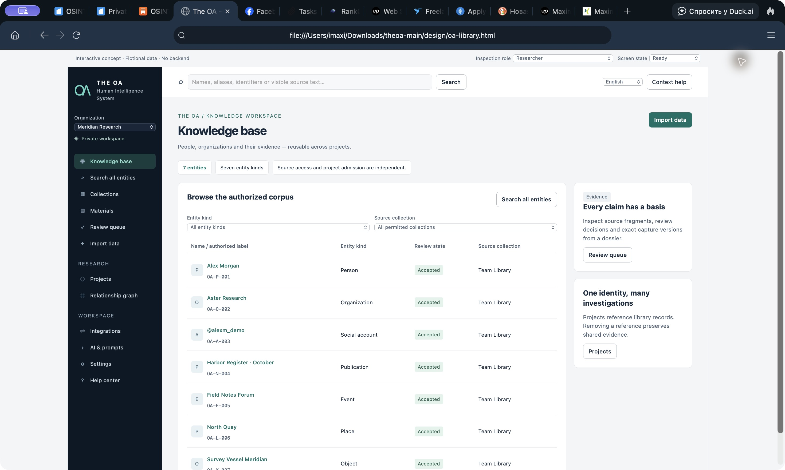</a>

*Knowledge-base screen captured in DuckDuckGo — UI Prototype 0.3.0, fictional data, no backend connection.*

### 14 Nov 2026 — OSINT Repos Intelligence Dataset

The full dated snapshot contains **4,484 repositories** covering OSINT, data collection, automation, infrastructure, and security research. The [public repository](https://github.com/bormaxi8080/osint-repos-list) provides a **100-record sample** and the Python generator; [full release and access details](https://osintech.substack.com/p/osint-repos-intelligence-dataset-62b) are published separately.

The generator collects GitHub metadata and produces JSON, Markdown, PDF, topic lists, and start.me bookmarks. Dated snapshots support comparison of newly added repositories.

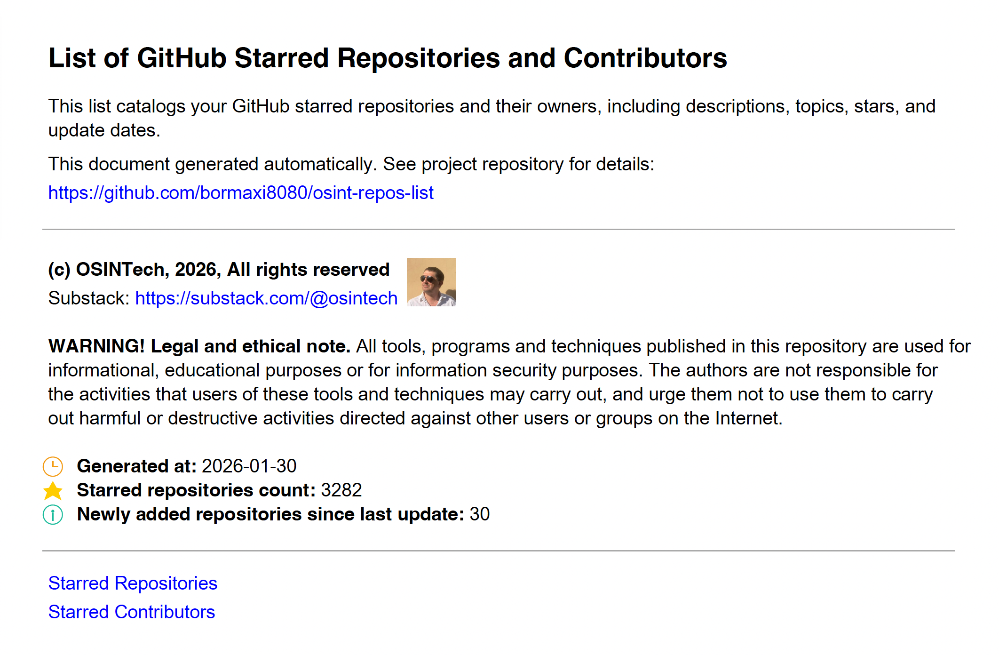

*Historical report screenshot — 30 January 2026, 3,282 repositories; it illustrates an earlier output rather than the 14 November snapshot.*

### Oct–Nov 2026 — Oriol v.2 / Kameleo: Browser Automation & Workflow Orchestration

A Python-based platform for managing browser automation through a centralized web interface, bringing together task scheduling, browser profiles, proxy management, and execution monitoring.

The architecture separates the control plane from task execution across runners and node agents, with PostgreSQL-backed operational state and versioned task revisions. Engineering focus: backend APIs, workflow orchestration, desktop and mobile browser execution, and operational observability.

**Status at review:** private project, 2.0 alpha; technical walkthrough available on request. Oriol v.1 remains a separate predecessor and was the collection platform used for the UFO Archive case study. That v.1 result is not presented as a v.2 case study.

<a href="img/dashboard.jpg">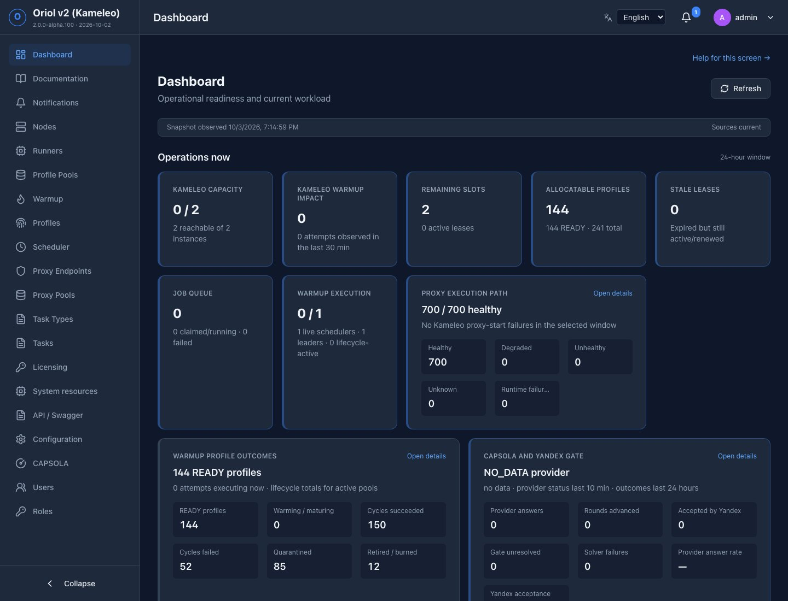</a>

*Web Admin screenshot — 3 October 2026, showing the alpha interface and operational state; not a production performance benchmark.*

### Sep 2026 — Martin

[Martin](https://github.com/bormaxi8080/martin-codex-pet) is a custom animated pet for Codex Desktop. He is an original, stylized interpretation inspired by the stage persona of British musician Martyn Jacques, founder and frontman of The Tiger Lillies.

### Aug 2026 — fcc-model-check

[fcc-model-check](https://github.com/bormaxi8080/fcc-model-check) is a Bash health-check utility for validating model routing between Free Claude Code (FCC) and NVIDIA NIM.

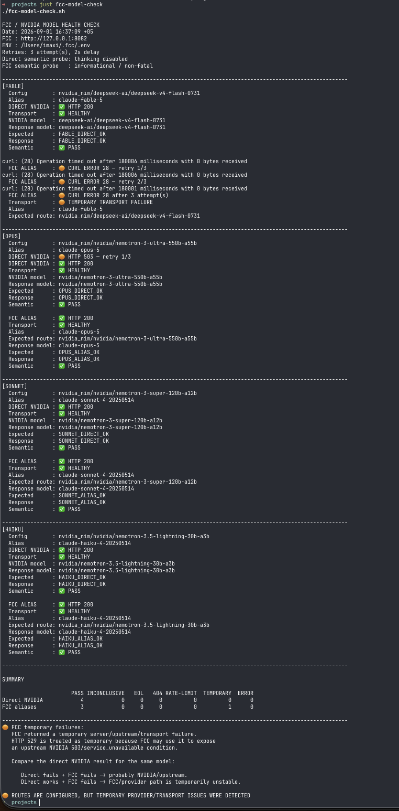

### Jun 2026 — Evidentia / Sourcely

Research and software engineering around source verification, evidence organization, data processing, and AI-assisted investigative workflows for journalists, fact-checkers, and OSINT researchers.

### Jun 2026 — just-ai

[just-ai](https://github.com/bormaxi8080/just-ai). This repository is a fork of just with additional just-ai functionality. The core just behavior stays the same: recipes from a justfile still run through the regular just binary, recipe syntax is unchanged, and existing projects do not need AI configuration. just-ai is shipped as an extension next to just, not as a replacement for it. It uses just --dump --dump-format json to read a structured description of the justfile, builds compact project context, scores command risk locally, and sends that context to a configured OpenAI-compatible provider only for AI commands.

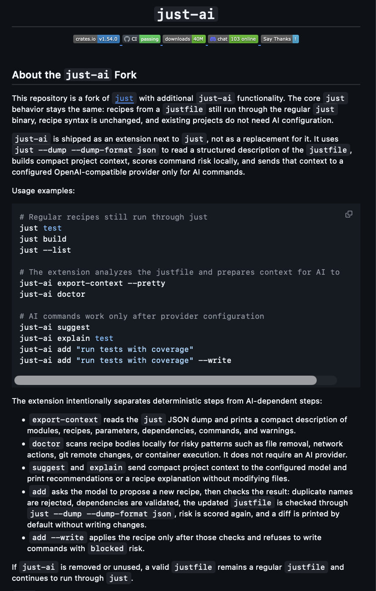

### Jun 2026 — Source Credibility Overlay: Extension & Backend API

[Source Credibility Overlay](https://github.com/bormaxi8080/sco-chrome-extension) is a Chrome extension and TypeScript/Fastify backend for collecting domain and page signals through RDAP, DNS, TLS, and metadata checks. The Docker Compose stack includes PostgreSQL-backed caching and shared TypeScript contracts.

**Status:** MVP with explainable rules and documented limitations. Signals support manual source verification; they do not establish that a site is truthful, false, or malicious.

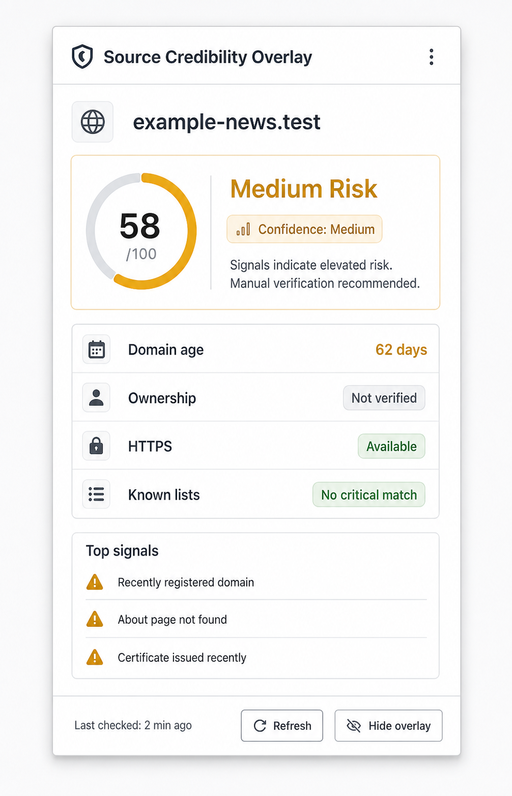

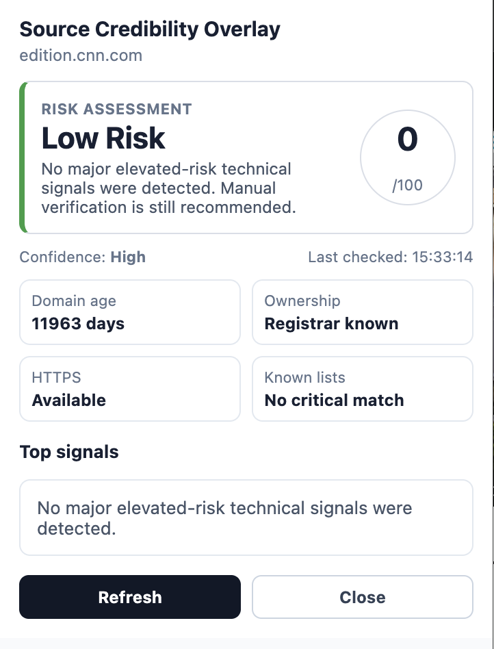

### Jun 2026 — Pravda New Prototype

A backend utility/service for capturing web pages as evidence: it opens a URL in real Chrome via Playwright, saves a snapshot of the page and metadata, so that it can later be provably shown: "This is what the page looked like at time X." Essentially, it's not a fact-checker per se, but an "evidence layer" for fact-checking/OSINT/archiving.

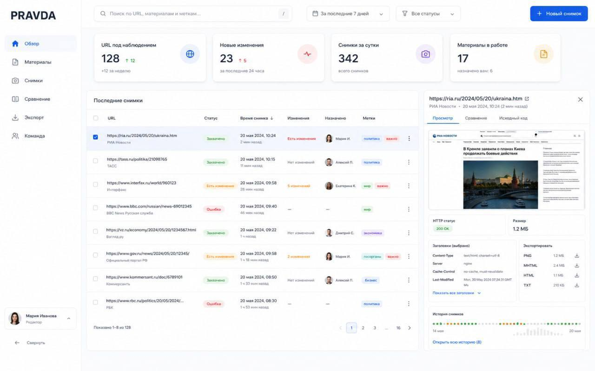

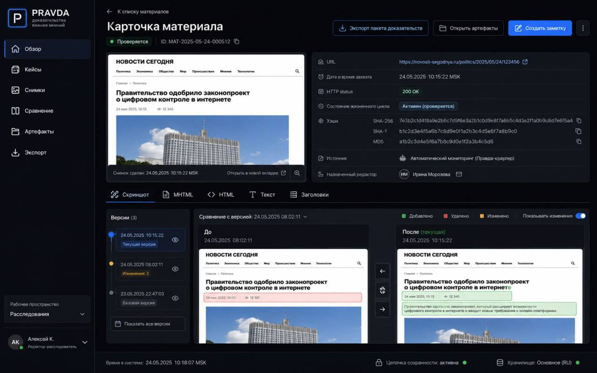

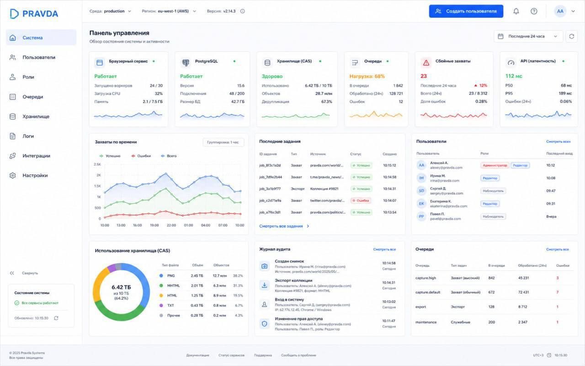

### Jun 2026 — UFO Archive: Structured Research Dataset

A structured snapshot of the [U.S. Department of War UFO archive](https://www.war.gov/UFO/), collected with **Oriol v.1**. The workflow transforms heterogeneous public source material into JSON for querying, archival research, enrichment, and downstream processing.

**Input:** public web archive. **Work:** crawling, extraction, normalization, and organization. **Output:** a reusable machine-readable research snapshot.

[Public collection case study](https://github.com/bormaxi8080/dow-ufo-archive) — workflow documentation; downloadable JSON is not currently included. The JSON screenshot below shows metadata from the **14 June 2026 snapshot, containing 294 records**.

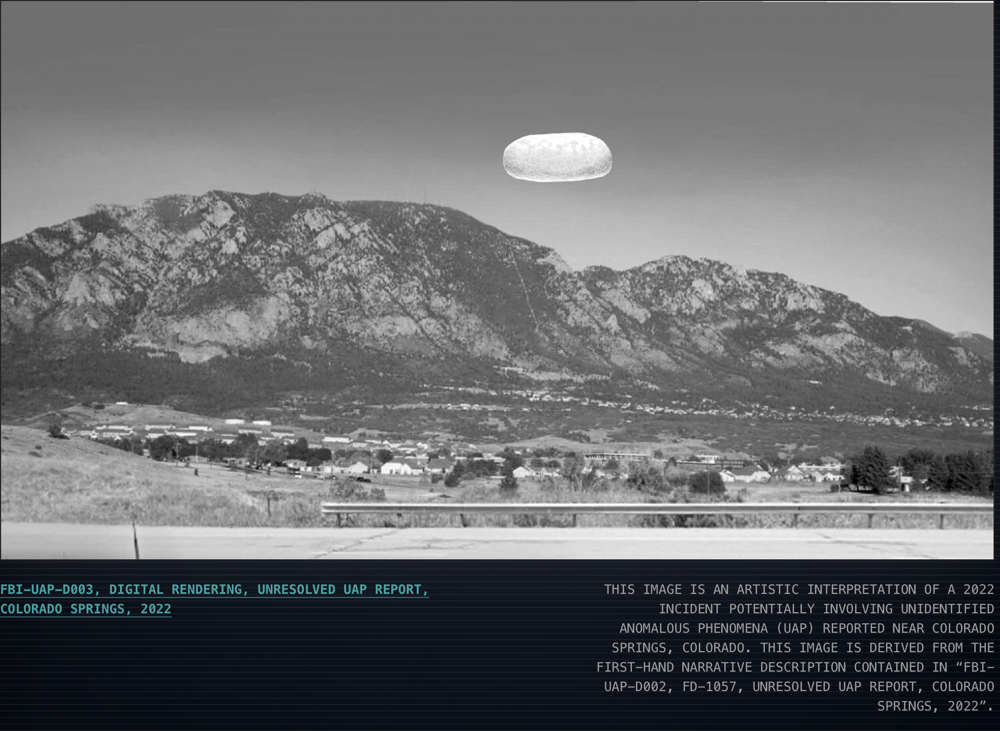

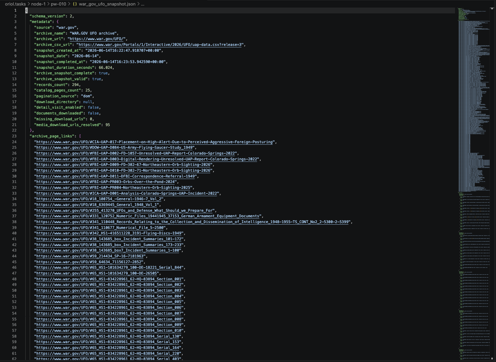

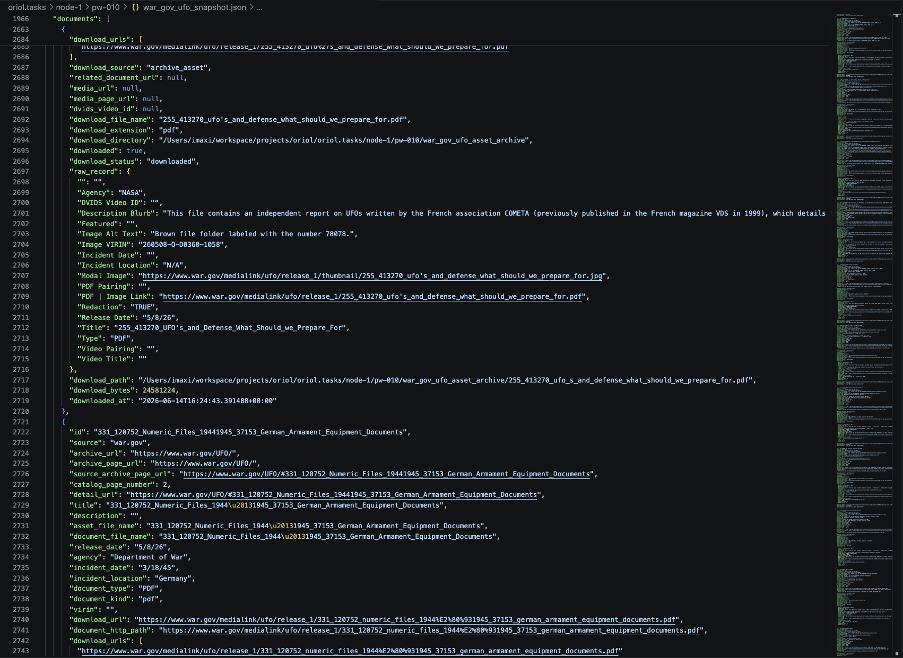

### Jun 2026 — theOA: Early Visual Identity Concepts

Historical branding explorations using the earlier “Human Resource Intelligence” wording. These images are visual identity concepts. The current research-workspace scope, design-stage status, and actual UI prototype are described in the November 2026 entry above.

### Jun 2026 — OpenRouter / Claude / NVIDIA Nemotron / CodeBase / Free Claude Code Experiments

OpenRouter/Claude/NVIDIA Nemotron/CodeBase/Free Claude Code Experiments

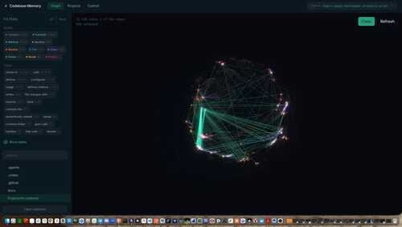

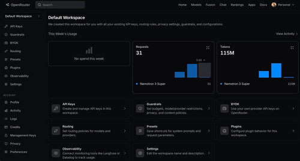

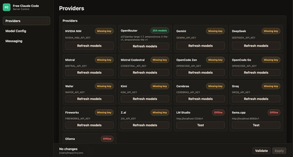

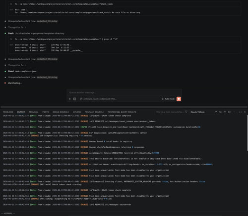

### May 2026 — Oriol v.1: Web Crawling & Data Collection

A modular Python-based platform for collecting heterogeneous web data with Playwright, Puppeteer, Camoufox, HTTP requests, and browser-profile environments. Collection scenarios are separated from individual sources to make workflows reusable and configurable.

**Engineering focus:** parallel and distributed collection, browser automation, reusable processing logic, and AI-assisted scenario generation. The [UFO Archive collection workflow](https://github.com/bormaxi8080/dow-ufo-archive) is a public v.1 case study. Technical walkthrough available on request.

Oriol v.1 is the predecessor to the separate Oriol v.2 / Kameleo alpha project described above.

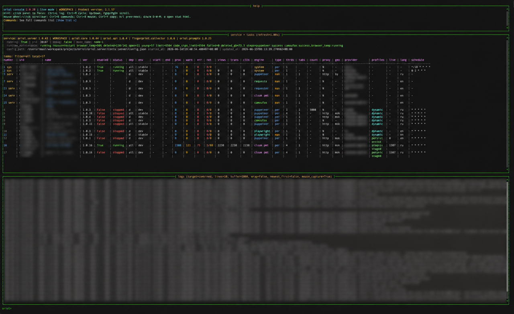

#### Oriol Fingerprint Collector

Standalone local diagnostic web server for browser and device fingerprint collection tests. This subproject is isolated from runtime.

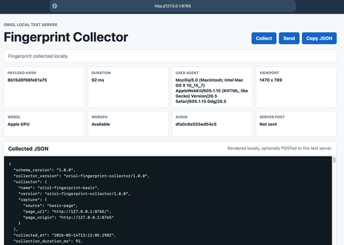

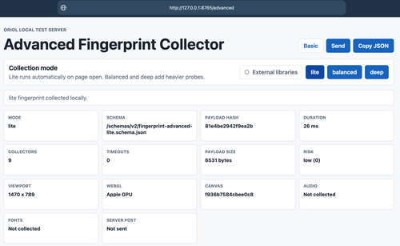

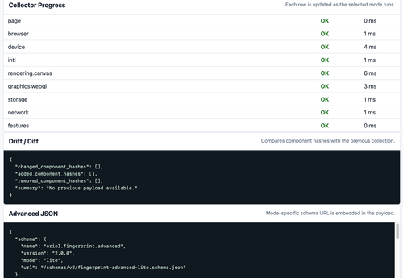

### Mar 2026 / Now — CyberYozh Academy

[CyberYozh Academy](https://academy.cyberyozh.com)

Act as Subject Matter Expert

### Aug 2025 / May 2026 — Tesari.AI

[Tesari.AI](https://tesari.ai)

Contributed as a Subject Matter Expert, Library Curator, and OSINT Engineer, working on research-data curation, source coverage, collection, enrichment, data-quality assessment, and QA of AI-generated investigative reports.

The dates above describe this historical engagement.

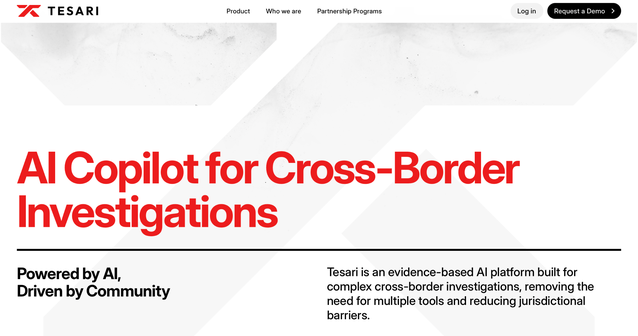

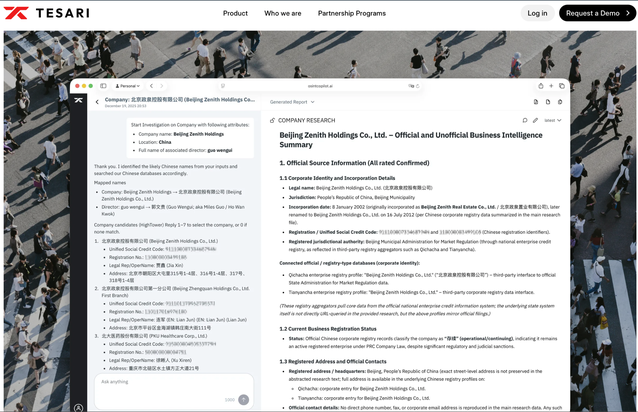

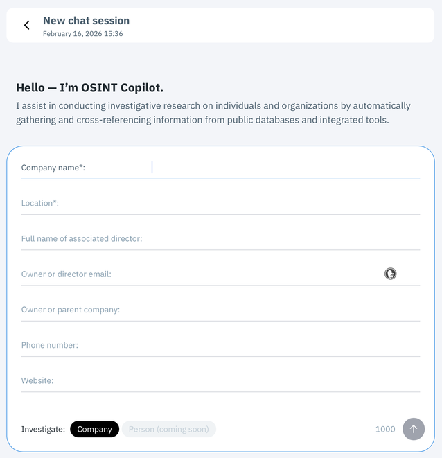

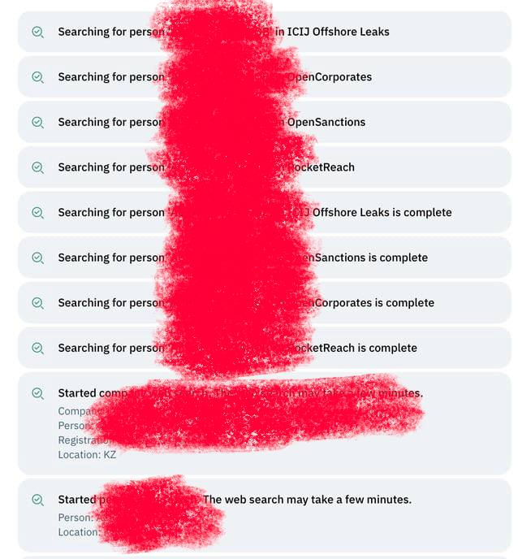

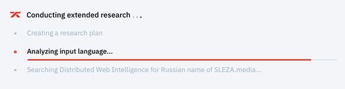

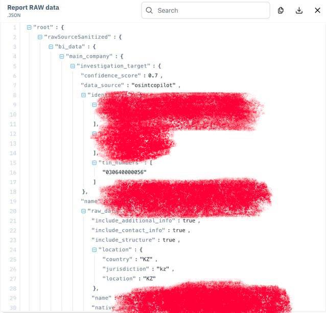

### Feb 2026 — CRPA Metadata Extractor

A service for checking images and videos for CR/CRPA tags, which identify an image or video as AI-generated content.

CR stands for Content Credentials. It is a digital label of content origin that: serves as a visible and invisible mark of an image's origin, indicates the source, generation tool (e.g., ChatGPT with DALL·E 3), and the date of production, indicates that the image was generated, in whole or in part, by AI.

Visible elements often include a small "cr" icon in the corner of the image. When clicked or hovered over, these elements can reveal details via metadata—the equivalent of a digital signature attached to the file.

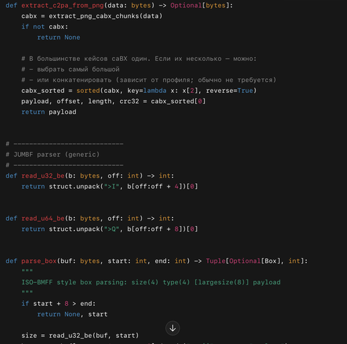

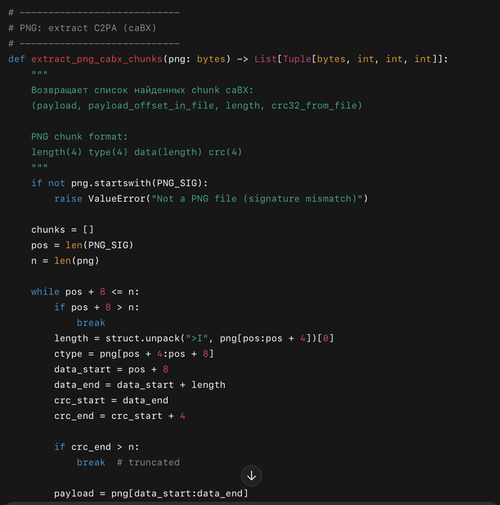

### Feb 2026 — OSINTech Scam Surface Mapper

[OSINTech Scam Surface Mapper](https://github.com/bormaxi8080/Scam-Surface-Mapper)

Scam Surface Mapper is a browser service based on GitHub Pages designed for OSINT investigators, fact-checkers, and cybersecurity researchers. It analyzes web pages to identify and visualize potential scam infrastructure by mapping outgoing links, analyzing suspicious domains, tracking parameters, and presenting findings in an interactive graph interface. The tool was created with the assistance of Perplexity AI & OpenAI Codex.

Modified version of [Pogoda Scam Surface Mapper](https://github.com/paulpogoda/Scam-Surface-Mapper)

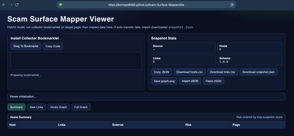

### May 2026 — Locus

Fork of Pavel Bannikov's repository **Locus** is an app for geolocating photos and video frames. It uses Google Maps by default and analyzes visual details to determine where and when an image was taken. Upload an image and let AI identify its location using landmarks, architecture, and environmental clues.

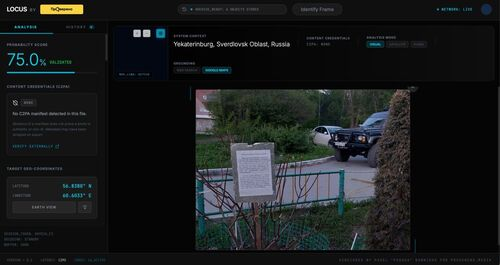

### Jan 2026 — Epstein Archive Parser: Investigative Document Processing

A private toolkit for acquisition and processing of the U.S. DOJ Epstein Archives: automated downloading, PDF parsing, duplicate detection, redaction analysis, and extraction for investigative review. The project processed approximately **89 GB of source material**.

**Private repository · Technical walkthrough available on request.** Processing figures and interpretation of redaction-analysis outputs require the relevant snapshot and methodology. Redaction analysis is not presented as proof that hidden text was recovered.

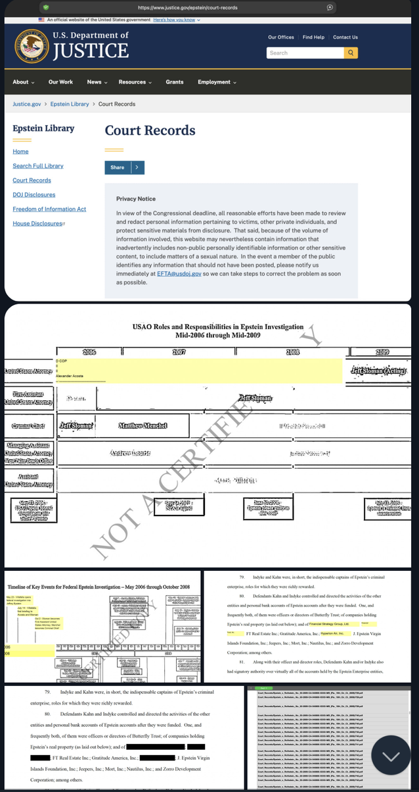

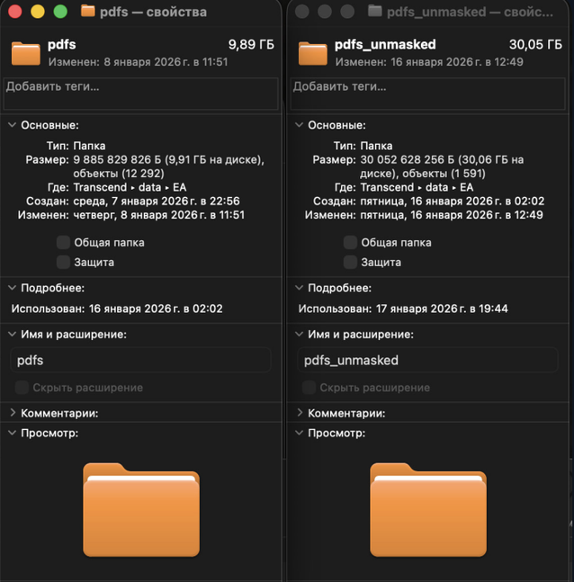

### Jan 2026 — IonaFlow

[IonaFlow](https://newsmonitor.app) News Monitor Integrations

IonaFlow is a news intelligence platform combining comprehensive source coverage with AI-powered analysis. The platform consolidates thousands of sources into organised, searchable feeds with flexible filtering.

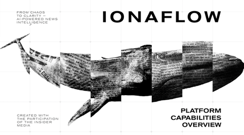

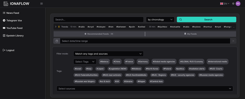

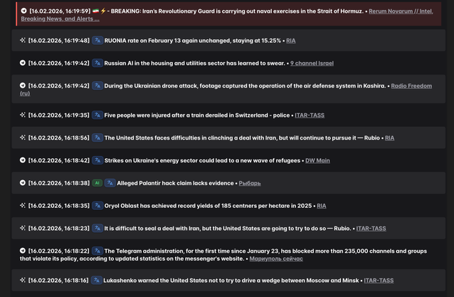

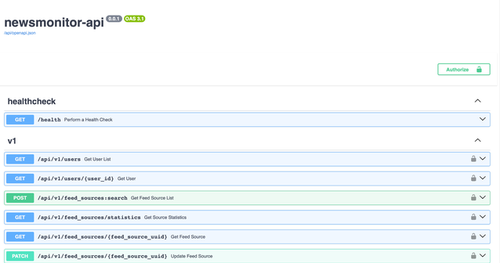

### Jan 2026 — OSINT Repos Intelligence Pack: Early Release

An earlier release of the repository-metadata collection, originally presented as the OSINT Repos Intelligence Pack, covering more than 3,000 GitHub repositories and their creators.

The project is now presented as the **OSINT Repos Intelligence Dataset**. The [public repository](https://github.com/bormaxi8080/osint-repos-list) contains the generator and a 100-record sample; full snapshots have separate [release and access details](https://osintech.substack.com/p/osint-repos-intelligence-dataset-62b). See the 14 November 2026 entry above for the 4,484-repository snapshot.

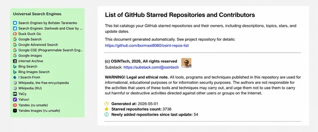

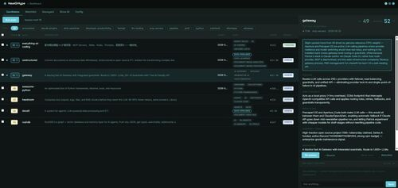

---
## 2025

### Dec 2025 — ABCs of Prompt Engineering

Together with [@paulpogoda](https://github.com/paulpogoda), we authored the course "ABCs of Prompt Engineering" on the specifics of AI and prompt engineering. The course consisted of four lectures and was held on the [kislorod.io](https://kislorod.io) platform.

Links: [1](https://youtu.be/ZjCBUa1SO14), [2](https://youtu.be/7bR25QI8zug), [3](https://youtu.be/PmQr18f-im0), [4](https://www.youtube.com/watch?v=TJfwld8qsRw)

### Apr 2023 / Now — OSINT Timelines and Collections

**OSINTech’s Timeline** is a weekly collection of OSINT tools, services, datasets, investigations, and research methods, maintained since 2023. It combines source monitoring, manual review, classification, and publication.

[Timeline archive on GitHub](https://github.com/bormaxi8080/osint-timeline) · [OSINTech’s OSINT Anatomy on Substack](https://osintech.substack.com/)

---

## 2024

### Aug 2024 / Sep 2025 — Profiling OSINT Courses

Completed [@paulpogoda](https://github.com/paulpogoda) Profiling OSINT Courses

---

## 2022–2024

### Jun 2022 / Now — OSINT & Investigative Journalistic Activities

Private projects about collecting social data.

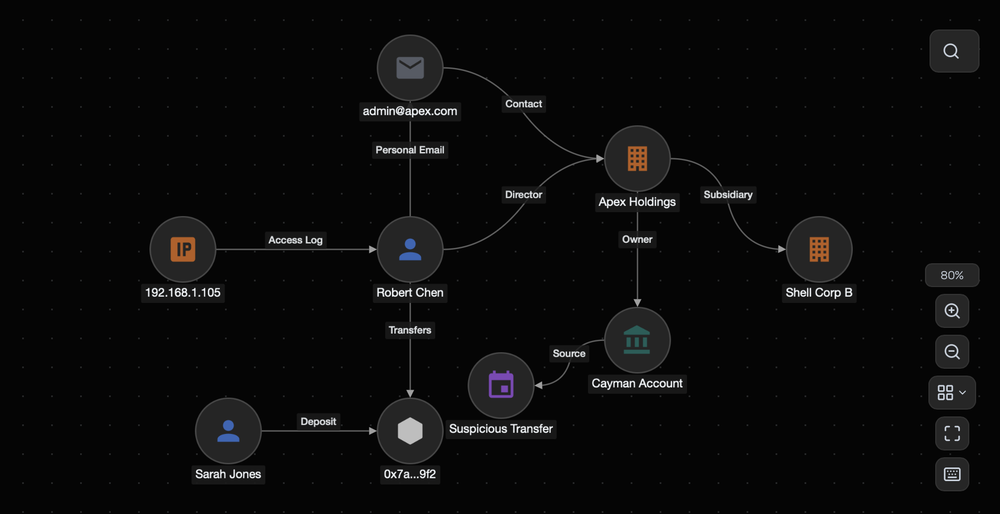

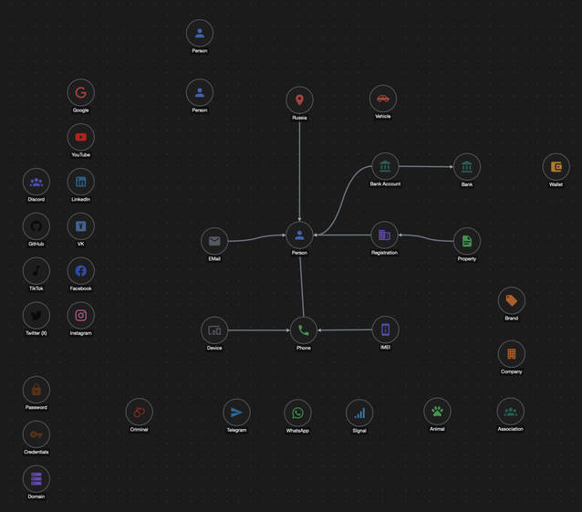

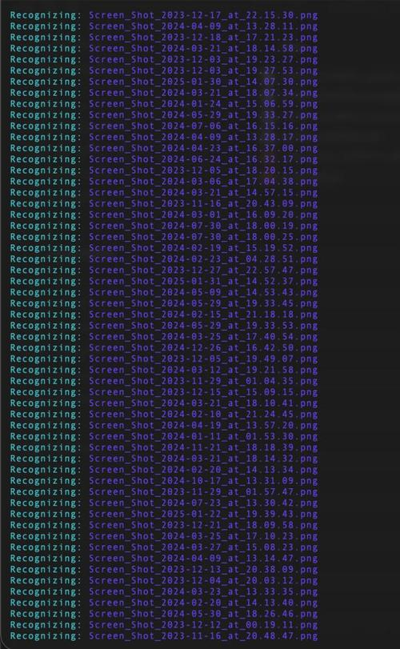

### Nov 2022 / Sep 2025 — Private AD Processing Projects

Private projects about AD processing (big conveyor)

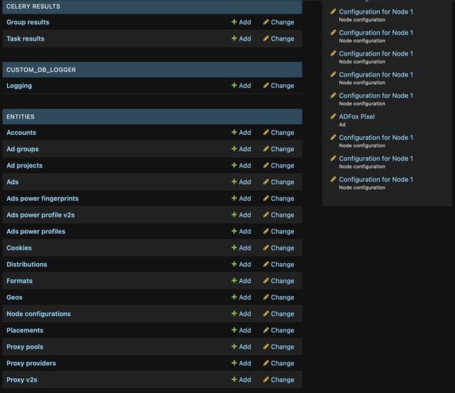

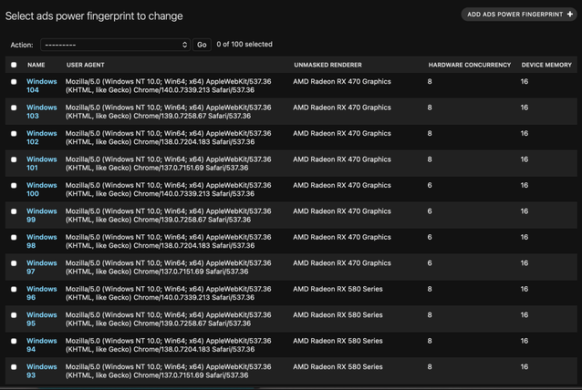

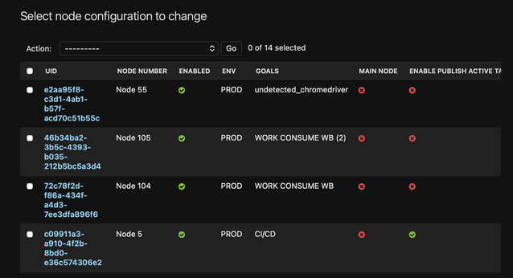

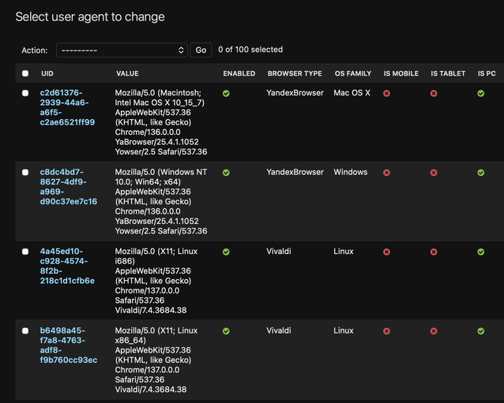

### Nov 2022 / Aug 2024 — Private OSINT Email Checking Projects

Private OSINT projects for email Checking (Big Conveyors), Database loading, verification, etc.

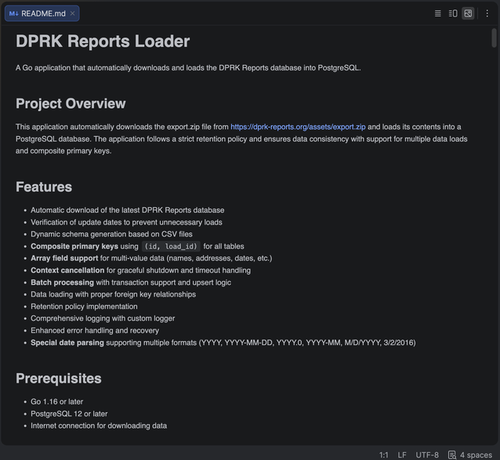

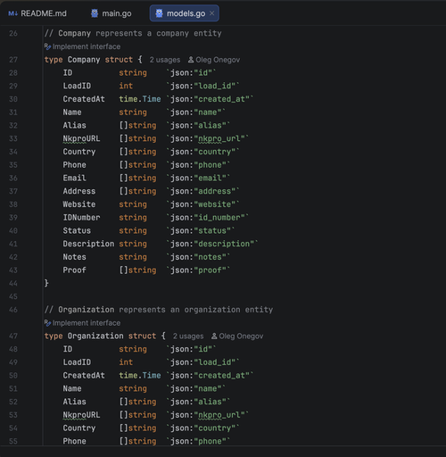

### Jan 2023 / Apr 2023 — LinkedIn Company Data Collection

Private project about collecting companies data on LinkedIn.

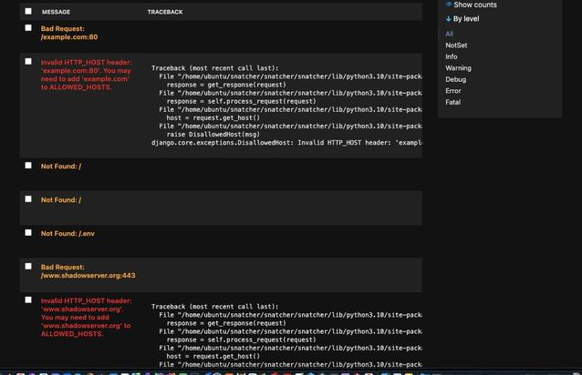

### Mar 2022 / Aug 2024 — War Crimes Documentation Project

War Crimes Documentation project help (non-disclosured).

### Sep 2022 — linkedin2md: Structured Profile Data Migration

[linkedin2md](https://github.com/bormaxi8080/linkedin2md) is a workflow for transforming heterogeneous professional-profile data into portable Markdown, JSON, PDF, and related research records. It was used while reorganizing a collection that grew to approximately **50,000 profiles**.

The project demonstrates format conversion, entity-centric organization, searchable records, and integration with Markdown/Obsidian workflows. It is an experimental workflow with documented limitations.

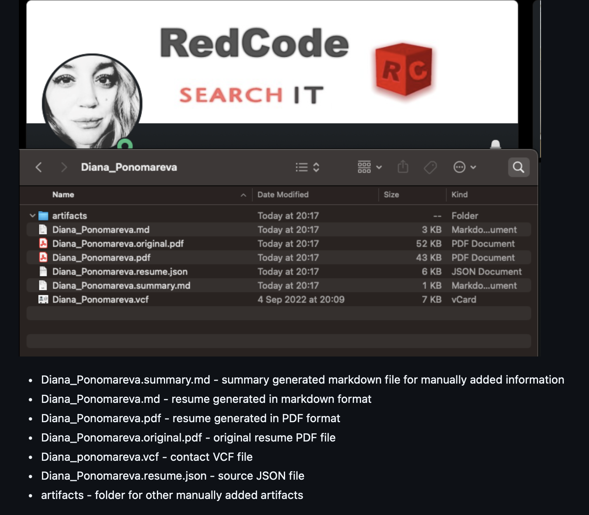

### 2022 — Huginn

[Huginn](https://github.com/bormaxi8080/huginn) private fork/community commits

### 2022 — OSINT Framework

[OSINT Framework fork](https://github.com/bormaxi8080/OSINT-Framework)

### 2022 — Telepathy

[Telepathy](https://github.com/bormaxi8080/Telepathy) project updates & [components](https://telepathy.freedesktop.org/components/)

### 2022 — facebook-ban-phrases

Start a [facebook-ban-phrases](https://github.com/bormaxi8080/facebook-ban-phrases) project, the list of phrases in different languages for which you can get banned on Facebook.

### Feb 2022 — batu-poll-checker

Create [batu-poll-checker](https://github.com/bormaxi8080/batu-poll-checker) utility for monitoring the results of voting for orangutan Batu in the election of a New Year's mascot in Novosibirsk, Russia, february 2022, with all the world and Russian media wrote about this incident.

### Jan 2022 — NMap Packet Domain List Scanner

Create a [NMap packet domain list scanner](https://github.com/bormaxi8080/nmap-scanner) utility, some OSINT tools experiments.

### Jun 2021 / Dec 2024 — RIP Leaks

A **RIP Leaks** community project, publicly oppose the processes of Russian import substitution, including in the IT sector, and cover news on this topic. Project closed.

---

## Earlier Projects

### Jun 2020 — Ebenya Rodiny

Start a Ebenya Rodiny project, one of the largest collections of graffiti and street art in the world.

### 2015 — Hiring Agency

A small warm tube recruitment agency. Recruitment geography: Novosibirsk, remote location, relocation from the RF to Europe (I took more than 260 families outside the Russian Federation).

Hiring candidates in IT from the middle level.

Automated candidate database of 30+ thousand people.

I created my own community, for 6 years I gained a lot of connections and insights among different companies at different times in the team from 1 to 6 recruiters.

Worked with companies such as Exness, Intel, Plesk, DevExperts, Think-Cell and many others.

A lot of different communications and activities.

### 2013 — Pencil Test

A [Pencil Test](https://habr.com/ru/articles/193902/) habr's publication with 1M+ views.

### 2000 / 2015 — Software Development in Various Projects

Software Development in various projects.

---
