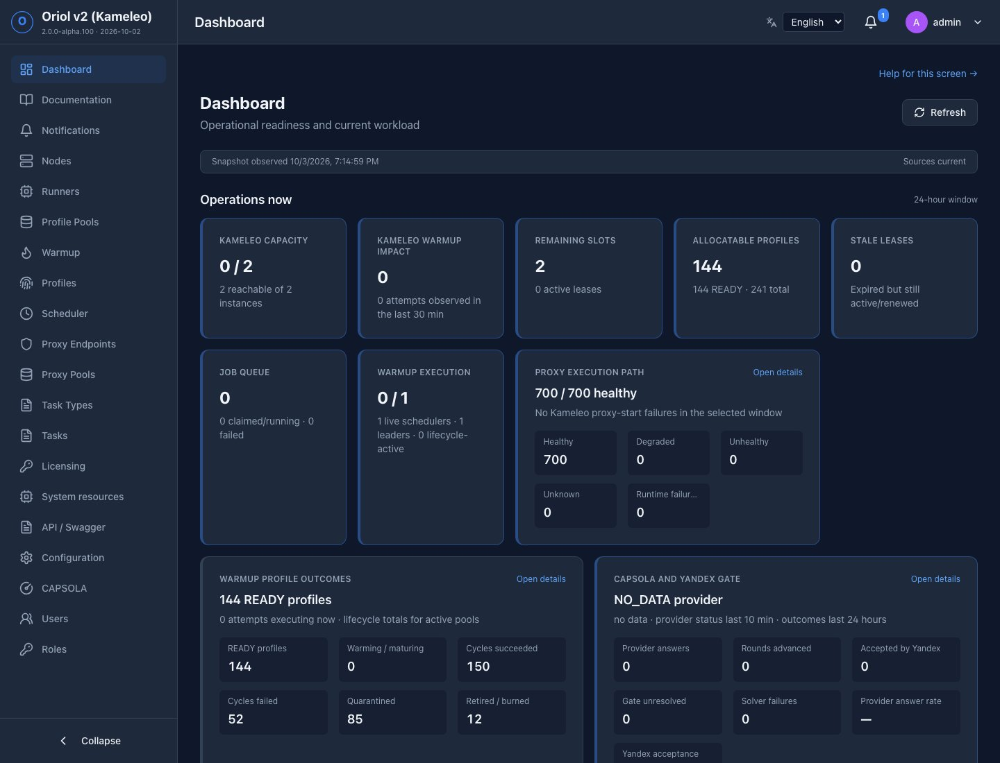
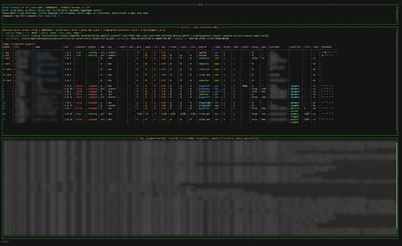
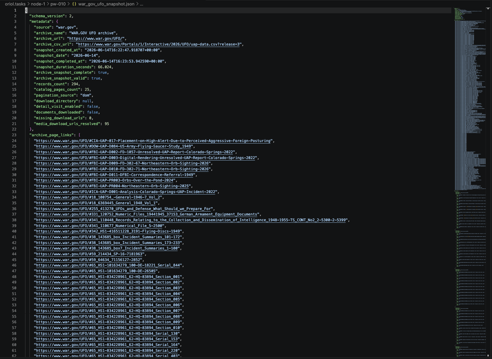
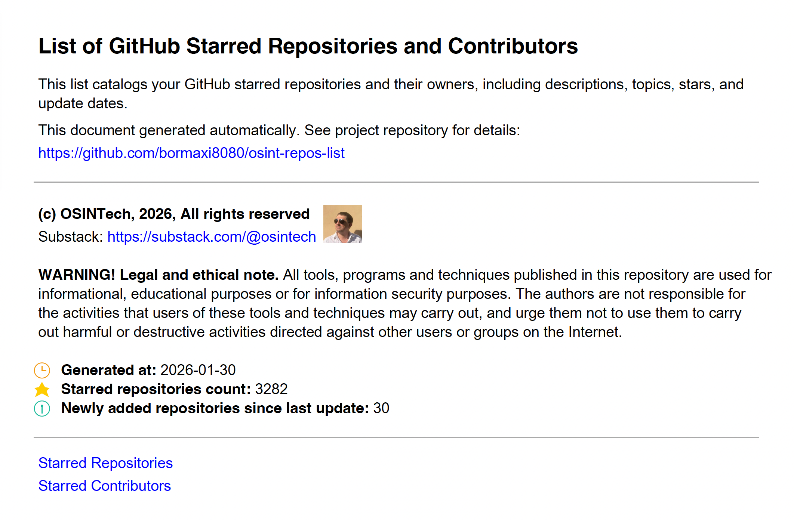
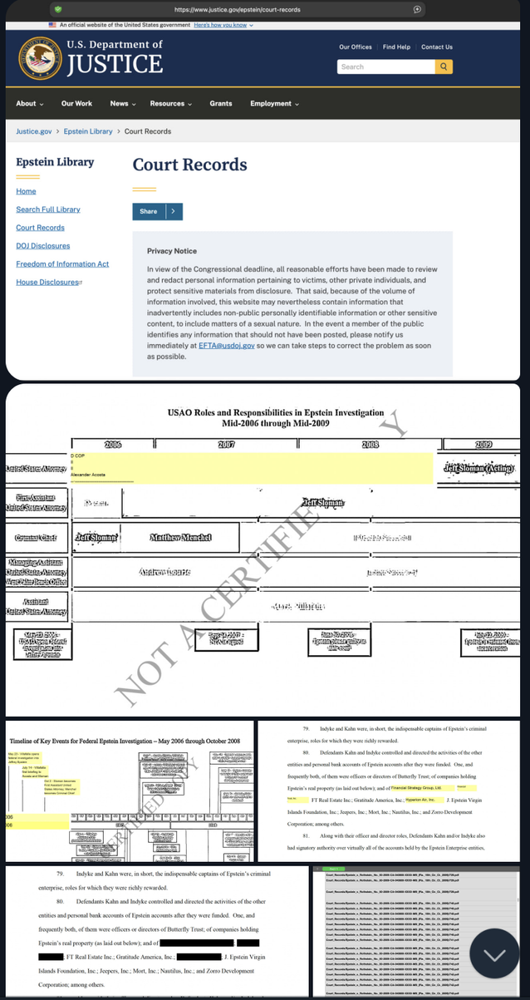
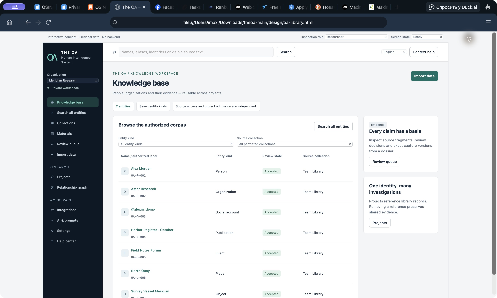
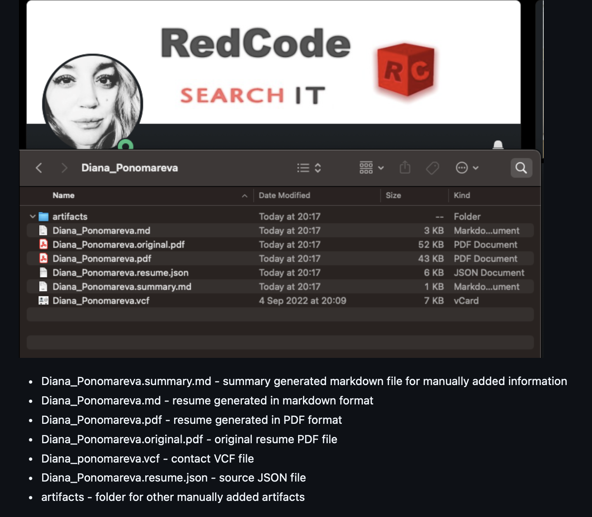

# Maxim Marshak / OSINTech

**Data & OSINT Engineer · Web Scraping · Backend Development**

I build tools and workflows for collecting, processing, and verifying public information: web crawlers, data pipelines, backend APIs, and structured research datasets.

My background combines **20+ years in software engineering** with **5+ years focused on OSINT and investigative research**.

**Core stack:** Python, SQL, PostgreSQL, JavaScript/TypeScript, Playwright, Docker, Linux.

I use AI for extraction, classification, coding, and workflow automation, combined with deterministic checks and source-based verification.

[Selected projects](#selected-projects) · [Upwork](https://www.upwork.com/freelancers/~0193a24bbe412ac7d0) · [LinkedIn](https://www.linkedin.com/in/osintech/) · [Substack](https://osintech.substack.com/) · Email: m.marshak@proton.me

**Workflow:** source collection → parsing and extraction → normalization and enrichment → validation and deduplication → structured data → research and analysis.

## Selected projects

### Oriol v.2 / Kameleo — Browser Automation & Workflow Orchestration

A Python-based platform for managing browser automation through a centralized web interface. It brings together task scheduling, browser profiles, proxy management, and execution monitoring.

The architecture separates the control plane from task execution across runners and node agents, with PostgreSQL-backed operational state and versioned task revisions. **Engineering focus:** backend APIs, workflow orchestration, desktop and mobile browser execution, and operational observability.

**Status:** private project · 2.0 alpha · technical walkthrough available on request.

*Web Admin dashboard — 3 October 2026 snapshot, showing the alpha interface and operational state.*

### Oriol v.1 — Web Crawling & Data Collection

A modular Python-based platform for collecting heterogeneous web data with Playwright, Puppeteer, Camoufox, HTTP requests, and browser-profile environments. Collection scenarios are separated from individual sources to make workflows reusable and configurable.

**Engineering focus:** parallel and distributed collection, browser automation, reusable processing logic, and AI-assisted scenario generation. **Public case study:** the [UFO archive collection workflow](https://github.com/bormaxi8080/dow-ufo-archive) below. Technical walkthrough available on request.

*Oriol v.1 console — the predecessor to v.2 and the collection platform used for the UFO Archive case study.*

### UFO Archive — Structured Research Dataset

A structured snapshot of the [U.S. Department of War UFO archive](https://www.war.gov/UFO/), collected with **Oriol v.1**. The workflow transforms heterogeneous public source material into JSON for querying, archival research, enrichment, and downstream processing.

**Input:** public web archive. **Work:** crawling, extraction, normalization, and organization. **Output:** a reusable machine-readable research snapshot.

[Read the archive collection case study](https://github.com/bormaxi8080/dow-ufo-archive) — public workflow documentation; downloadable JSON is not currently included.

*JSON output example — metadata from the 14 June 2026 snapshot, containing 294 records.*

### OSINT Repos Intelligence Dataset

A repository-metadata collection covering OSINT, data collection, automation, infrastructure, and security research. The **14 November 2026 full snapshot contains 4,484 repositories**; the public repository provides a **100-record sample** and the Python generator.

The generator collects GitHub metadata and produces JSON, Markdown, PDF, topic lists, and start.me bookmarks. Dated snapshots support comparison of newly added repositories.

[Generator and public sample](https://github.com/bormaxi8080/osint-repos-list) · [Full release and access details](https://osintech.substack.com/p/osint-repos-intelligence-dataset-62b)

*Historical report example — 30 January 2026, 3,282 repositories. The later full snapshot described above contains 4,484 repositories.*

### Source Credibility Overlay — Extension & Backend API

A Chrome extension and TypeScript/Fastify backend that collect domain and page signals through RDAP, DNS, TLS, and metadata checks. The Docker Compose stack includes PostgreSQL-backed caching and shared TypeScript contracts.

This is an **MVP with explainable rules**, with limitations documented in the repository. Signals support manual source verification; they do not establish that a site is truthful, false, or malicious.

[Source Credibility Overlay: code, setup, and limitations](https://github.com/bormaxi8080/sco-chrome-extension)

*Interface example on a demonstration news page — domain signals and an explainable prompt for manual verification.*

### Epstein Archive Parser — Investigative Document Processing

A toolkit for acquisition and processing of the U.S. DOJ Epstein Archives: automated downloading, PDF parsing, duplicate detection, redaction analysis, and extraction for investigative review. The project processed approximately **89 GB of source material**.

**Private repository · Technical walkthrough available on request.** Processing figures and interpretation of redaction-analysis outputs can be discussed with the relevant snapshot and methodology.

*Project overview — source archive, document examples, and processing output.*

### theOA — Human Intelligence & Research Workspace

An OSINT research-system concept for organizing people, organizations, source materials, and evidence-backed relationships in a shared knowledge base. Investigations reuse records while preserving data provenance, review states, and the separation between source access and project participation.

**Engineering and design focus:** entity and evidence modeling, relationship graphs, modular backend architecture, versioned data contracts, and planned provider-neutral AI analysis with versioned prompts and explicit processing permissions.

**Status:** private, design-stage project with an interactive English/Russian UI prototype using fictional data, a preliminary OpenAPI contract, and a Python API scaffold. Business authentication, authorization, ingestion, and persistence are not implemented; no production release has been published. Concept and architecture walkthrough available on request.

*Knowledge-base screen captured in DuckDuckGo — UI Prototype 0.3.0, fictional demonstration data, no backend connection.*

### linkedin2md — Structured Profile Data Migration

A workflow for transforming heterogeneous professional-profile data into portable Markdown, JSON, PDF, and related research records. It was used while reorganizing a collection that grew to approximately **50,000 profiles**.

The project demonstrates format conversion, entity-centric organization, searchable records, and integration with Markdown/Obsidian workflows. It is an experimental workflow with documented limitations.

[linkedin2md: workflow and examples](https://github.com/bormaxi8080/linkedin2md)

*Documented conversion example — a profile organized into portable files and supporting artifacts.*

## Technical stack

| Area | Tools and methods |
| --- | --- |
| Collection | Python, Playwright, Puppeteer, Camoufox, HTTP APIs, scraping and crawling |
| Data | SQL, PostgreSQL, ClickHouse, JSON/CSV, normalization, enrichment, deduplication |
| Backend | TypeScript/JavaScript, Node.js, Django, REST APIs, Celery, RabbitMQ |
| Automation | Bash, Ruby, Perl, Docker, Linux, AWS |
| AI-assisted workflows | LLM extraction and classification, coding agents, source-based verification |

My broader engineering background includes legacy systems, integrations, databases, infrastructure, and software in C/C++, Java/.NET, PHP, and other stacks.

## Research, publications & current work

**OSINTech’s Timeline** is a weekly collection of OSINT tools, services, datasets, investigations, and research methods, maintained since 2023. It combines source monitoring, manual review, classification, and publication.

[Timeline archive on GitHub](https://github.com/bormaxi8080/osint-timeline) · [OSINTech’s OSINT Anatomy on Substack](https://osintech.substack.com/) · [Start Here](https://osintech.substack.com/p/start-here-a-guide-to-osintechs-osint)

**Evidentia / Sourcely:** research and engineering around source verification, evidence organization, data processing, and AI-assisted investigative workflows.

**Tesari.AI:** OSINT engineering and research-data curation, including collection, source coverage, enrichment, data-quality assessment, and QA of generated investigative reports.

## Additional tools & experiments

- [just-ai](https://github.com/bormaxi8080/just-ai): my extension of the upstream `just` command runner, adding project-context analysis, local command-risk checks, and optional AI assistance. Upstream attribution and fork details are documented in the repository.
- [fcc-model-check](https://github.com/bormaxi8080/fcc-model-check): diagnostics for model availability and routing between FCC and NVIDIA NIM.
- [Scam Surface Mapper](https://github.com/bormaxi8080/Scam-Surface-Mapper): a modified fork for mapping web infrastructure in OSINT research.
- [IP & Location Widget](https://github.com/bormaxi8080/location-widget): a lightweight widget for start.me boards.
- [Martin](https://github.com/bormaxi8080/martin-codex-pet): an experimental animated companion for Codex Desktop.

The [project history](CHANGELOG.md) includes further prototypes, evidence-capture work, publications, and earlier engineering projects.

## Professional principles

I work openly under my real identity and support independent research, investigative journalism, human-rights work, and democratic civic initiatives.

I publicly oppose Russia's war against Ukraine and support projects documenting state and war crimes.

I do not collaborate with Russian public-sector institutions, Russian banks, or import-substitution-related companies.

## Contact & support

For data collection, backend development, OSINT tooling, and research projects: [Upwork](https://www.upwork.com/freelancers/~0193a24bbe412ac7d0), [LinkedIn](https://www.linkedin.com/in/osintech/), or m.marshak@proton.me.

If my tools or publications help your work, you can [support OSINTech on Buy Me a Coffee](https://buymeacoffee.com/osintech).
